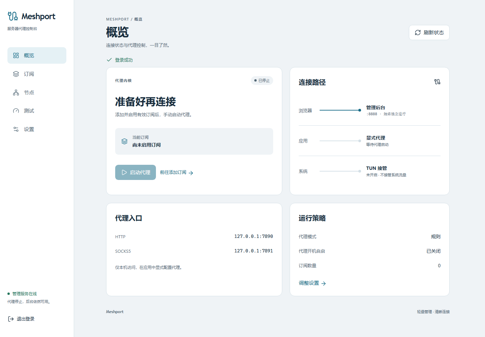

# Meshport

**在浏览器里管理 Linux 服务器的代理。无需桌面环境，停止代理后，管理后台依然可用。**

Meshport 是一个面向个人服务器和单管理员的轻量级代理管理工具，使用 Go + Vue 3 开发，底层采用 [Mihomo](https://github.com/MetaCubeX/mihomo) 内核。你可以通过 Web 后台添加订阅、选择节点、调整代理模式，并按需开启 TUN 接管系统流量。

前端资源已嵌入管理程序，服务器运行时无需安装 Node.js。管理后台和代理内核分别由独立的 systemd 服务运行。

[下载安装包](https://github.com/shushu594088/meshport/releases/latest) · [使用方法](#开始使用) · [安装方法](#安装) · [开发文档](docs/DEVELOPMENT.md) · [验证记录](docs/VERIFICATION.md)



*示例界面；截图中的端口和订阅数量来自测试配置。*

## 项目介绍

Meshport 适合需要在 Linux 服务器上管理代理、又希望通过浏览器完成日常操作的用户。

- **浏览器管理**：概览、订阅、节点、设置四个页面，展示运行状态、当前订阅和操作结果。
- **订阅管理**：支持 Mihomo / Clash YAML 订阅地址及手动粘贴，可保存多份订阅，每次启用一份。
- **节点选择**：展示策略组、节点和当前选择；手动选择结果持久化保存。
- **代理控制**：启动、停止、重启代理，单独设置代理开机自启。
- **三种模式**：规则、全局、直连；TUN 使用独立开关。
- **默认仅本机代理**：HTTP / SOCKS5 默认监听回环地址；外部访问需要独立认证。
- **配置失败保护**：先验证再应用，失败时保留上一份有效配置。
- **TUN 自动恢复**：开启后需在 60 秒内确认可访问，否则自动恢复；恢复计时器不依赖浏览器或后台进程持续在线。
- **原生部署**：提供 amd64、arm64 安装包及安装、卸载脚本。

当前版本为 **v0.1.0**。Ubuntu 22.04 amd64 已完成真实内核、浏览器交互、端口迁移、TUN 回滚和卸载重装验证。Debian、arm64 硬件与整机重启尚未完成实机验收，详见[验证记录](docs/VERIFICATION.md)。

第一版不包含 Base64 / 通用节点 URI 转换、订阅节点合并、Docker 部署、多用户或内置证书管理。

## 安装

**普通用户直接从 GitHub Releases 下载安装包，无需克隆源码，也无需安装 Go 或 Node.js。**

### 一键安装（推荐）

在服务器上执行这一条命令：

```bash
curl -fsSL https://raw.githubusercontent.com/shushu594088/meshport/main/install.sh | sudo bash
```

自动识别系统、系统版本与处理器架构，读取最新稳定 Release 的安装清单，下载对应安装包、校验 SHA-256、安装系统依赖并完成部署。安装后输出后台地址与一次性初始化凭证。

**默认 Web 开机自启，代理内核不开机自启，代理与 TUN 均关闭。**

这条命令保持不变。后续增加 CentOS 等发行版或发布新版本时，脚本根据 Release 的系统匹配清单自动选择对应安装包；当前实际支持 Ubuntu 和 Debian，其他系统会明确提示暂不支持。

已有安装不会被直接覆盖；升级请先保留数据卸载。首次安装可指定后台端口或固定版本：

```bash
curl -fsSL https://raw.githubusercontent.com/shushu594088/meshport/main/install.sh | sudo bash -s -- --port 8889
curl -fsSL https://raw.githubusercontent.com/shushu594088/meshport/main/install.sh | sudo bash -s -- --version v0.1.0
```

需要本机已有 curl 和 sudo。root 账号可将 `sudo bash` 改为 `bash`。

### 环境要求

| 项目 | 要求 |
| --- | --- |
| 系统 | Ubuntu / Debian，运行 systemd |
| 架构 | amd64（`x86_64`）或 arm64（`aarch64`） |
| 权限 | root，或可以使用 sudo 的账号 |
| 网络 | 在线安装需要访问 GitHub 下载固定版本的 Mihomo |
| 运行依赖 | curl、gzip、coreutils、iproute2、sudo、CA 证书 |

### 手动下载安装包（可选）

在要安装 Meshport 的服务器上执行。以下命令自动识别架构，下载 **v0.1.0** 并校验安装包：

```bash
sudo apt update
sudo apt install -y curl gzip coreutils iproute2 sudo ca-certificates

VERSION=0.1.0
case "$(uname -m)" in
  x86_64) ARCH=amd64 ;;
  aarch64|arm64) ARCH=arm64 ;;
  *) echo "不支持的处理器架构"; exit 1 ;;
esac

RELEASE_URL="https://github.com/shushu594088/meshport/releases/download/v${VERSION}"
curl -fLO "${RELEASE_URL}/meshport-${VERSION}-linux-${ARCH}.tar.gz"
curl -fLO "${RELEASE_URL}/SHA256SUMS"
sha256sum --ignore-missing -c SHA256SUMS

mkdir -p "meshport-${VERSION}"
tar -xzf "meshport-${VERSION}-linux-${ARCH}.tar.gz" -C "meshport-${VERSION}"
cd "meshport-${VERSION}"
sudo bash install.sh
```

也可以从 [Releases 页面](https://github.com/shushu594088/meshport/releases)手动下载对应架构的压缩包，解压后运行 `sudo bash install.sh`。

首次安装时自定义 Web 端口：

```bash
sudo bash install.sh 8889
```

安装脚本会检查系统、架构、端口与 systemd，创建专用用户和目录，并下载 **Mihomo v1.19.32**，校验固定的官方 SHA-256 后安装。

安装完成后：

- 管理后台启动，并设置为开机自启。
- 代理和 TUN 默认关闭。
- 终端输出访问地址及一次性初始化凭证。

离线安装时，可将官方的 `mihomo-linux-amd64-compatible-v1.19.32.gz` 或 `mihomo-linux-arm64-v1.19.32.gz` 放在安装包解压目录，再运行安装脚本；脚本仍会验证固定 SHA-256。

## 开始使用

### 1. 打开管理后台

在浏览器访问：

```text
http://服务器IP:8888
```

使用自定义端口时替换 `8888`。需要放行对应的服务器防火墙或安全组端口。

### 2. 首次初始化

将安装输出中的一次性凭证填入页面，设置管理员密码后进入后台。管理员密码至少 12 个字符，且不超过 72 字节。

如果没有保存安装输出，在服务器上读取凭证：

```bash
sudo cat /var/lib/meshport/init-token
```

初始化成功后，凭证失效，文件会被删除。后续使用管理员密码登录；登录会话有效期为 12 小时。修改管理员密码后，所有已登录会话失效。

### 3. 添加并启用订阅

进入 **订阅 → 添加订阅**，输入名称，然后选择：

- **订阅 URL**：填写提供 Mihomo / Clash YAML 的 HTTP(S) 地址。
- **粘贴 YAML**：直接导入完整配置或节点列表。

验证通过后，点击该订阅的 **启用**。可以保存多个订阅，但每次只启用一个。

### 4. 启动代理并选择节点

在 **概览** 页面点击 **启动代理**，再进入 **节点** 页面查看策略组与节点。

手动选择策略组可以切换节点；自动策略组展示内核的选择结果。内核停止时，节点操作不可用，后台仍能管理订阅和设置。

### 5. 在应用中使用代理

默认端口：

| 入口 | 默认地址 | 用途 |
| --- | --- | --- |
| Web 后台 | `0.0.0.0:8888` | 浏览器管理 |
| HTTP 代理 | `127.0.0.1:7890` | 应用显式配置 HTTP 代理 |
| SOCKS5 代理 | `127.0.0.1:7891` | 应用显式配置 SOCKS5 代理 |

在安装 Meshport 的服务器上测试 HTTP 代理：

```bash
curl --proxy http://127.0.0.1:7890 https://example.com
```

使用 SOCKS5，并由代理解析域名：

```bash
curl --proxy socks5h://127.0.0.1:7891 https://example.com
```

默认其他主机不能访问代理端口。如需外部访问，在 **设置** 中开启对应选项，并设置独立的代理用户名和密码。代理认证与 Web 管理员密码分别管理。

### 6. 调整代理模式

在 **设置** 中选择模式并保存：

| 模式 | 行为 |
| --- | --- |
| 规则 | 按当前配置的规则分流 |
| 全局 | 使用内核的全局策略组，可在节点页查看和选择 |
| 直连 | 流量直接连接 |

模式决定流量如何分流；TUN 决定是否接管系统流量，两者独立。

### 7. 按需开启 TUN

先启动代理，再在 **设置** 中开启 **接管系统流量** 并保存。必要的公网管理来源或网段，应先填入额外绕行网段。

开启后，在 **60 秒内**确认 SSH、后台和 DNS 正常，点击 **确认后台可访问**。未确认时，独立的 systemd 计时器会自动恢复启用前的配置，即使浏览器断开或管理后台停止也会执行。

TUN 默认绕行私有网络、本机、root 和本工具进程，以及开启时的后台来源地址。复杂多网卡或其他公网管理来源需要自行设置绕行网段。

## 订阅与节点

完整配置保留订阅中的策略组和规则；节点列表使用内置基础模板，私有网络直连，其余流量进入代理选择组。

- 最多保存 64 份订阅，单份最大 8 MiB。
- 支持 HTTP 和 inline 集合；不读取任意本地文件集合。
- 不支持 Base64、通用节点 URI 或 YAML 别名，导入时会显示具体原因。
- 节点选择按订阅保存；更新后已选节点不存在时，清除失效选择并显示提示。
- 删除当前启用的订阅前，先切换其他有效订阅，或停止代理。
- URL 订阅可以手动更新；粘贴导入没有更新 URL，需要重新导入。

## 架构与配置管理

```text
浏览器 → Go 管理服务 → SQLite / 本地配置
                    ├→ 受限的固定操作辅助程序 → systemd
                    └→ 本机认证控制接口 → Mihomo

meshport.service          管理后台，独立运行
meshport-mihomo.service    代理内核，按需运行
```

前端资源嵌入 Go 程序，服务器无需 Node.js。管理服务使用专用用户；需要权限的服务控制由只允许固定操作的本地辅助程序执行，内核通过 systemd 获得 TUN 所需的网络能力。

| 位置 | 内容 |
| --- | --- |
| `/etc/meshport` | 后台环境配置 |
| `/var/lib/meshport` | SQLite 状态、订阅缓存、生成配置及恢复日志 |
| journald | 后台日志与服务生命周期事件 |

浏览器只访问管理服务；Mihomo 控制接口仅对本机开放并启用认证，不向浏览器暴露内核密钥。管理员密码保存 bcrypt 哈希；代理凭证和订阅信息保存在权限受限的本地数据中。

配置应用使用跨进程锁和持久化恢复日志。新配置通过内核验证后才应用，失败时保留原配置；内核恢复失败时，后台仍可启动并显示原因。模式、端口、自启和节点选择均持久化保存。

Web、HTTP、SOCKS5 端口范围为 1024–65535，互不重复；9090 为本机内核控制端口，1053 为本机 DNS 保留端口。修改代理入口会短暂重启内核。修改 Web 端口时先启用新监听，再关闭旧监听；使用反向代理时需同步修改上游。

## 常用服务命令

```bash
# 管理后台
sudo systemctl start meshport
sudo systemctl stop meshport
sudo systemctl restart meshport

# 代理内核
sudo systemctl start meshport-mihomo
sudo systemctl stop meshport-mihomo
sudo systemctl restart meshport-mihomo

# 启用 / 关闭代理开机自启，不会立即启动或停止代理
sudo systemctl enable meshport-mihomo
sudo systemctl disable meshport-mihomo

# 查看状态和日志
sudo systemctl status meshport meshport-mihomo
sudo journalctl -u meshport -u meshport-mihomo -n 100 --no-pager
```

通常优先在 Web 后台调整代理自启，使持久化设置与服务状态保持一致。内核标准输出关闭，避免第三方订阅错误回显凭证；后台验证错误以脱敏信息呈现。

## TUN 与故障恢复

如果开启 TUN 后无法访问，可通过 SSH 停止代理：

```bash
sudo systemctl stop meshport-mihomo
```

随后回到仍独立运行的管理后台，关闭 TUN 并保存，检查网络后再启动代理。严重网络异常时，可以通过服务器控制台执行同一停止命令。

不要直接重启仍保存着错误 TUN 设置的内核。每次启动已保存的 TUN 配置，都会重新建立 60 秒确认窗口。

本工具使用 `meshport0`、保留路由表 20220 与规则起始优先级 9200。停止时仅清理本工具的网络状态，不修改 `/etc/resolv.conf`，不清空系统全局路由或防火墙规则。

## HTTPS 与公网访问

后台默认提供 HTTP，公网使用建议通过 Nginx / Caddy 接入 HTTPS。先配置反向代理，上游指向实际后台端口，并保留正确的 Host。

反向代理正常工作后，可编辑 `/etc/meshport/environment`：

```ini
MESHPORT_HOST=127.0.0.1
MESHPORT_SECURE_COOKIE=true
```

然后执行 `sudo systemctl restart meshport`。内置证书申请和续期不在第一版范围内。

## 升级与卸载

在安装包解压目录执行：

```bash
sudo bash uninstall.sh
```

通过一键入口安装的用户，可直接执行 `sudo bash /usr/libexec/meshport-uninstall`；加 `--purge` 可明确清除全部 Meshport 数据。

默认停止服务并移除程序，**保留管理员密码、订阅和设置**。升级时先默认卸载，再使用新版本安装包安装；重新安装保留已有数据和代理自启选项，不会在安装过程中自动启动代理。

明确需要删除全部 Meshport 数据时：

```bash
sudo bash uninstall.sh --purge
```

这会同时删除本工具的数据目录、配置目录及专用用户。

## 从源码构建

构建机器需要 **Go 1.25+** 与 **Node.js 22.12+**。

```bash
git clone https://github.com/shushu594088/meshport.git
cd meshport
bash scripts/build.sh
```

生成：

```text
build/meshport-0.1.0-linux-amd64.tar.gz
build/meshport-0.1.0-linux-arm64.tar.gz
build/SHA256SUMS
```

Windows 可运行 `powershell -File scripts/build.ps1`；Go 和 Node.js 应位于 PATH 中。

单独构建与检查：

```bash
npm --prefix web ci
npm --prefix web run build
go test ./...
go vet ./...
go build -o build/meshport ./cmd/meshport
go build -o build/meshport-helper ./cmd/meshport-helper
```

更多目录结构、API、测试与开发驱动说明见[开发文档](docs/DEVELOPMENT.md)。完整的验证范围与未覆盖场景见[验证记录](docs/VERIFICATION.md)。

## 反馈与依赖

使用中遇到问题，可以提交 [Issue](https://github.com/shushu594088/meshport/issues)。请附系统版本、处理器架构、Meshport 版本、复现步骤及脱敏后的错误信息。

Meshport 使用 Go、Vue 3、Lucide、SQLite 等依赖，第三方许可文本见 [THIRD_PARTY_NOTICES.txt](THIRD_PARTY_NOTICES.txt)。Mihomo 由安装脚本从上游单独下载，其许可与说明见 [Mihomo 项目](https://github.com/MetaCubeX/mihomo)。
